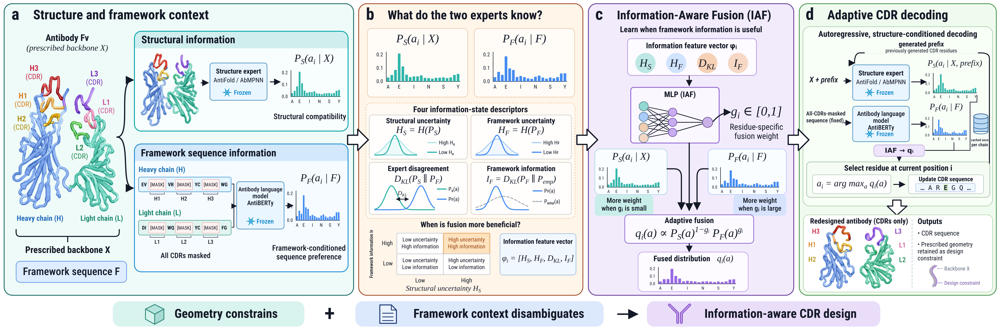
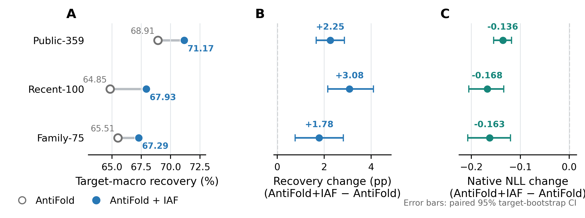
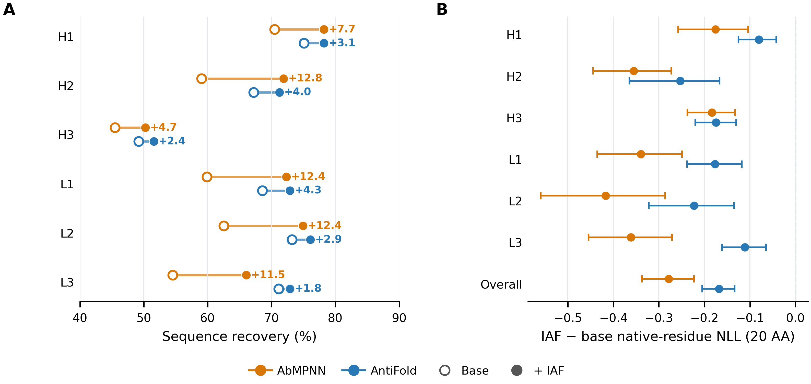
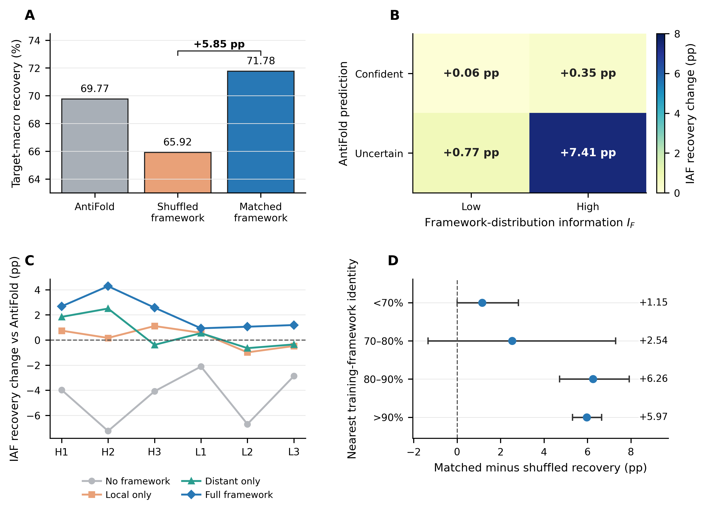

# AbRefine

### Framework-Conditioned Refinement for Structure-Guided Antibody CDR Design

AbRefine refines the residue distributions of a frozen antibody inverse-folding
model with framework-conditioned information from a frozen antibody language
model. Its Information-Aware Fusion (IAF) module contains only 49 trainable
parameters and assigns a different fusion strength to every designed residue.
Native CDR identities are never supplied as model inputs.

[Method](#method) ·
[Results](#results) ·
[Installation](#installation) ·
[Quick start](#quick-start) ·
[Reproduction](#reproducing-the-workflow) ·
[Data contract](docs/DATA_SCHEMA.md)

## Highlights

- **Consistent generalization:** IAF improves recovery by **+2.25 pp** on the
  public benchmark, **+3.08 pp** on a recent external panel, and **+1.78 pp**
  on a family-disjoint reserve.
- **Portable refinement:** the same formulation improves both AntiFold and
  AbMPNN, with gains of **+2.95 pp** and **+9.35 pp**, respectively, over their
  original sampled recovery.
- **Target-specific framework signal:** matched frameworks outperform
  mask-matched shuffled frameworks by **+5.85 pp**.
- **Lightweight and modular:** IAF learns only 49 parameters while both
  pretrained experts remain frozen.

## At a glance

| Component | Implementation |
|---|---|
| Design input | Paired heavy–light backbone and observed framework sequence |
| Structural expert | AntiFold (primary) or AbMPNN; expert weights remain frozen |
| Framework expert | AntiBERTy with every CDR on the queried chain masked simultaneously |
| Information state | Structural entropy, framework entropy, expert disagreement, framework information |
| Fusion module | 4–8–1 MLP with SiLU activation; 49 trainable parameters |
| Output | Residue-specific adaptive product-of-experts distribution |
| Development data | 62 antibodies; complete targets remain grouped |
| Evaluation | Public benchmark, recent external panel, and family-disjoint reserve |

## Method

At position i, the frozen structure and framework experts return distributions
P_S and P_F. IAF summarizes their information state as

~~~text
phi_i = [
    H(P_S),
    H(P_F),
    KL(P_S || P_F),
    KL(P_F || P_emp)
]

g_i = sigmoid(logit(0.59) + MLP_4-8-1(standardize(phi_i)))

P_R(a) ∝ P_S(a)^(1-g_i) · P_F(a)^g_i
~~~

P_emp is an empirical prior estimated only from development antibodies by CDR
type and normalized loop position. The released predictor averages three IAF
members trained with seeds 41, 42, and 43. During closed-loop design, each
refined residue is fed back to the structural expert, whereas the all-CDR-masked
framework distributions are computed once and cached.

## Results

### Generalization across evaluation sets

The same frozen AntiFold-based IAF ensemble improves antibody-macro recovery
and native-residue NLL on all three evaluation cohorts.

| Cohort | Targets | Baseline | Baseline + IAF | Recovery change (95% CI) | NLL change (95% CI) |
|---|---:|---:|---:|---:|---:|
| Public-359 | 359 | 68.91% | **71.17%** | **+2.25 pp** [+1.66, +2.86] | **−0.136** [−0.154, −0.118] |
| Recent-100 | 100 | 64.85% | **67.93%** | **+3.08 pp** [+2.15, +4.10] | **−0.168** [−0.205, −0.134] |
| Family-75 | 75 | 65.51% | **67.29%** | **+1.78 pp** [+0.76, +2.82] | **−0.163** [−0.208, −0.120] |

Confidence intervals are based on 10,000 paired target-level bootstrap
replicates. The public cohort excludes three exact-PDB overlaps with the
development collection.

### Portability across structural experts

On Recent-100, each method generates 20 samples per antibody at temperature 0.2.
AntiFold uses fixed-table open-loop sampling; AbMPNN uses autoregressive
closed-loop sampling. Settings are matched within each structural expert.

| Structural expert | Original | Static PoE | IAF | IAF vs original | IAF vs static |
|---|---:|---:|---:|---:|---:|
| AbMPNN | 56.50% | 64.32% | **65.85%** | **+9.35 pp** | **+1.53 pp** |
| AntiFold | 64.53% | 67.30% | **67.48%** | **+2.95 pp** | +0.18 pp |

IAF reduces generated-context native-residue NLL for both experts. Separate
deterministic-design fold-back evaluations show no statistically detectable
increase in locally aligned CDR backbone RMSD. For AntiFold, the extra recovery over static
PoE is not statistically significant; its additional value is mainly improved
native likelihood.

### Why the matched framework matters

- Matched frameworks outperform exact-mask-matched shuffled frameworks by
  **+5.85 pp** (95% CI +5.26 to +6.47).
- The largest refinement gain, **+7.41 pp**, occurs when the structure expert
  is uncertain and the framework-conditioned distribution is informative.
- Generic, local-only, or distant-only priors do not reproduce the full
  matched-framework effect.

Machine-readable summaries and statistical details are available in
[results/RESULTS.md](results/RESULTS.md) and the accompanying JSON files.

## Installation

Clone the repository and install the lightweight fusion package:

~~~bash
git clone git@github.com:liuqi98/AbRefine.git
cd AbRefine
python -m pip install -e .
~~~

The core package requires NumPy. Install the test extra to run the unit suite:

~~~bash
python -m pip install -e ".[test]"
python -m pytest -q
~~~

AntiFold, AbMPNN, and AntiBERTy are external pretrained models and are not
redistributed here. Their outputs are consumed through per-residue probability
tables. Expert scoring and IAF training additionally require the packages in
requirements-models.txt and local installations of the corresponding official
models.

## Quick start

Apply the released AntiFold IAF ensemble to a per-residue JSONL file:

~~~bash
abrefine iaf \
  --structure path/to/structure_log_probabilities.jsonl \
  --evolution path/to/framework_log_probabilities.jsonl \
  --empirical-prior path/to/empirical_prior.jsonl \
  --model models/iaf_antifold.json \
  --output path/to/refined_predictions.jsonl
~~~

Use the AbMPNN-calibrated ensemble by replacing the model argument:

~~~bash
abrefine iaf \
  --structure path/to/structure_log_probabilities.jsonl \
  --evolution path/to/framework_log_probabilities.jsonl \
  --empirical-prior path/to/empirical_prior.jsonl \
  --model models/iaf_abmpnn.json \
  --output path/to/refined_predictions.jsonl
~~~

The three JSONL inputs are joined by patch_id. Their exact required fields and
amino-acid order are documented in
[docs/DATA_SCHEMA.md](docs/DATA_SCHEMA.md).

### Released IAF models

| File | Structural expert | Intended use |
|---|---|---|
| models/iaf_antifold.json | AntiFold | Primary benchmark and closed-loop decoding |
| models/iaf_abmpnn.json | AbMPNN | Cross-expert transfer and sampling experiments |

The JSON files contain feature-scaling statistics, ensemble weights, seeds,
architecture metadata, and provenance hashes; they do not contain empirical
test records or third-party model checkpoints.

## Reproducing the workflow

### 1. Score the masked framework

~~~bash
python scripts/score_antiberty_all_cdr_mask.py \
  --chains path/to/antibody_chains.jsonl \
  --model-root path/to/official/AntiBERTy \
  --output path/to/framework_probabilities.jsonl \
  --device cuda
~~~

Every annotated CDR position on the queried chain is masked in the same
AntiBERTy forward pass.

### 2. Train and export IAF

~~~bash
python scripts/train_iaf.py \
  --structure path/to/development_structure.jsonl \
  --framework path/to/development_framework.jsonl \
  --output outputs/iaf_antifold \
  --base-expert AntiFold
~~~

Splits are target grouped. Model fitting, feature standardization, empirical
prior construction, early stopping, and model selection use development
targets only. The portable ensemble is written to
outputs/iaf_antifold/iaf_ensemble.json.

### 3. Run closed-loop design

~~~bash
python scripts/score_antifold_iaf_closed_loop.py \
  --checkpoint path/to/antifold_checkpoint.pt \
  --inputs path/to/antifold_inputs.csv \
  --pdb-dir path/to/pdb_directory \
  --manifest path/to/residue_manifest.jsonl \
  --priors path/to/framework_probabilities.jsonl \
  --empirical path/to/empirical_prior.jsonl \
  --iaf-model models/iaf_antifold.json \
  --output path/to/designs.jsonl \
  --device cuda:0
~~~

The script recomputes the structural distribution after every selected residue
and reuses the cached framework distribution.

## Repository map

~~~text
.
├── src/abrefine/
│   ├── iaf.py                  # IAF inference and model loading
│   ├── fusion.py               # Product-of-experts utilities
│   ├── io.py                   # Validated per-residue I/O
│   └── cli.py                  # abrefine command-line entry point
├── models/
│   ├── iaf_antifold.json
│   └── iaf_abmpnn.json
├── scripts/
│   ├── train_iaf.py
│   ├── score_antiberty_all_cdr_mask.py
│   └── score_antifold_iaf_closed_loop.py
├── results/                    # Tables, confidence intervals, and receipts
├── docs/figures/               # Model and evaluation figures
└── tests/                      # Unit and command-line tests
~~~

## Evaluation contract

1. Native CDR residues are hidden from both experts at design time.
2. AntiBERTy sees the retained framework and simultaneous masks at all CDR
   positions on the corresponding chain.
3. Development and evaluation targets are disjoint; complete antibodies stay
   together during model fitting and bootstrap resampling.
4. Analysis thresholds, empirical priors, standardization statistics, and IAF
   weights are frozen before evaluation.
5. Recovery is macro-averaged by antibody. Confidence intervals resample
   complete targets rather than individual residues.
6. Duplicate identifiers, inconsistent region annotations, and records lacking
   the no-native-CDR assertion are rejected.

## Repository status

This is a private research release accompanying the AbRefine manuscript. Raw
SAbDab structures, native evaluation sequences, and third-party checkpoints are
not redistributed. The included scripts, portable IAF weights, summary results,
and provenance receipts are intended to make the fusion layer auditable and
reusable once users provide the corresponding model outputs.

## Citation

Citation metadata will be updated after the preprint receives a persistent
identifier. For now, cite the repository and the accompanying AbRefine
manuscript.

## License

Licensing terms for the code will be added before public release. Third-party
data and pretrained models remain subject to their original terms.

## Evaluation definitions

Public-359 excludes PDB IDs present in the development collection. Recent-100
contains recent SAbDab structures; Family-75 is a reserve with heavy-chain and
antigen families disjoint from development. The combined 534 cohort records
represent 533 unique PDB/H/L pairs and 447 PDB entries, not 534 unique antibodies.

+Static denotes fixed-weight AntiBERTy fusion (AntiFold: 0.59; AbMPNN: 0.69),
selected separately on development data. +IAF denotes residue-specific fusion.
For shuffled-framework controls, framework probabilities, information features,
and gates are recomputed while structural predictions and learned parameters
remain fixed. Recovery is averaged over ten donor assignments within each target.
The empirical-prior control instead uses development CDR-type/position frequencies
with its own development-selected static weight (0.43).

Detailed protocols and scoring conventions: [docs/EVALUATION.md](docs/EVALUATION.md).
